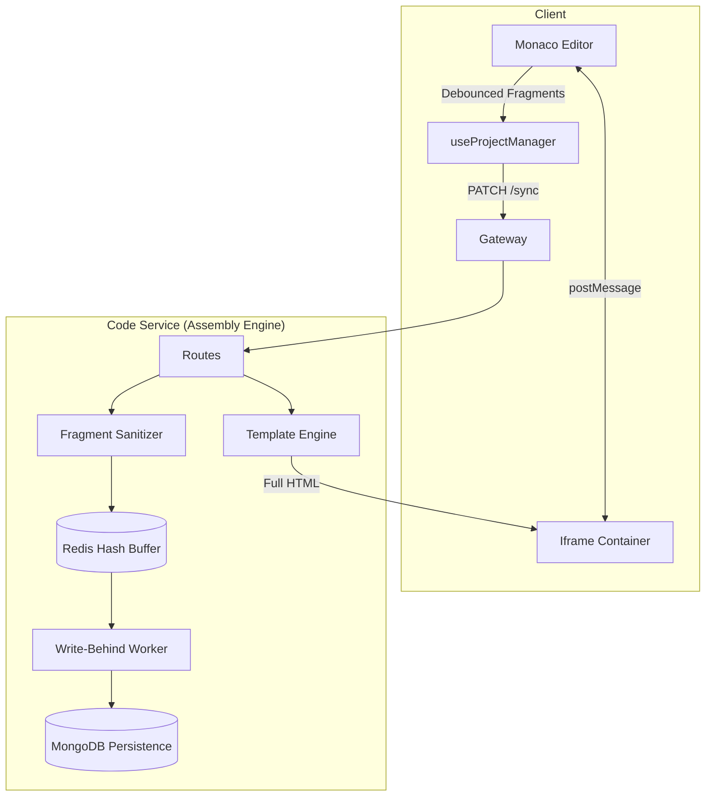

# CEditor

A professional-grade Browser Editor application built with a microservices architecture, featuring aggressive contest security, a fragment-based assembly engine, and multi-layered data persistence.

## 🚀 Services Overview

| Service Name | Port | Description |
| ------------ | ---- | ----------- |
| **API Gateway** | 3000 | Entry point for all requests, handles routing, rate limiting, and security headers. |
| **Auth Service** | 3001 | Handles JWT authentication (Access/Refresh), registration, and session management. |
| **User Service** | 3002 | Manages user profiles with Kafka-driven synchronization. |
| **Code Service** | 3003 | **Core Engine**: Handles fragment-based storage, assembly, and Redis write-behind sync. |
| **Frontend** | 3005* | Next.js (App Router) with hardened security deterrents and local IndexedDB. |

## 🏗️ Architecture: Fragment-Based Wrapper Approach

The application uses a **Fragment-Based Wrapper Approach** to ensure code isolation, security, and flexible preview rendering.



### 🧩 Granular Functionality

#### 1. Storage & Separation
- **Fragment Extraction**: The backend automatically identifies and strips `<html>`, `<head>`, and `<body>` tags from user input, storing only the inner fragments.
- **Dedicated Fields**: user code is persisted as three distinct components:
  - `html`: Sanitized <body> content.
  - `css`: Extracted `<style>` tag contents.
  - `js`: Extracted `<script>` tag contents.

#### 2. Redis Write-Behind Strategy
- **Low-Latency Updates**: Frontend sends small PATCH requests containing only modified fragments (e.g., only CSS changes).
- **Redis Buffering**: Updates are stored in a Redis Hash (`project:buffer:{id}`). This minimizes database I/O and provides near-instant synchronization.
- **The Flusher**: A background worker performs bulk updates from Redis to MongoDB every 60 seconds using optimized `$set` operations.

#### 3. Secure Assembly Engine
- **The Wrapper**: All previews are generated using a controlled `<!DOCTYPE html>` template.
- **System Injections**: Non-removable scripts are injected for:
    - **Visibility Monitoring**: Detects tab switching and sends violations to the parent.
    - **Navigation Blocking**: Prevents accidental page escapes via link clicks.
    - **Error Catching**: Proxies console errors and runtime exceptions.

## 🛡️ Security Hardening

### 🔒 Content & Platform Security
- **Strict Sanitization**: Powered by `isomorphic-dompurify`. Removes all `script`, `style`, and `iframe` tags from the HTML fragment, preventing XSS while keeping styles/scripts in their "owned" fields.
- **Iframe Sandboxing**: Previews are served with `sandbox="allow-scripts"`.
- **MIME Sniffing Prevention**: Preview endpoint enforces `X-Content-Type-Options: nosniff`.
- **Focus Tracking**: Strike system (3 warnings) for tab switching or exiting fullscreen.

### 🛡️ Contest Deterrents
- **Console Lockdown**: Real-time `debugger` loop detects and penalizes devtool usage.
- **Keyboard Lockdown**: Blocks `F12`, `Ctrl+Shift+I`, `Alt+Tab` (via blur detection).
- **Anti-Cheating**: `visibilitychange` events are proxied from the preview iframe to the monitoring system.

## 💾 Data Persistence Layers
- **L1: Monaco Memory**: Immediate local state.
- **L2: IndexedDB**: Client-side backup every 2s for crash recovery.
- **L3: Redis Buffer**: In-memory fragment buffer for high-frequency updates.
- **L4: MongoDB**: Final persistent storage with revision snapshots.

## 🔑 Authentication & Data Flow

CEditor uses a multi-service authentication handshake to ensure security and data consistency.

### 🔄 Auth Handshake & Header Injection
1.  **Credential Submission**: User provides `email` and `password` via the login form.
2.  **Token Issuance**: `Auth Service` validates credentials and returns a JWT **Access Token**.
3.  **Gateway Injection**: For every request to the backend, the **API Gateway** intercepts the JWT, verifies it via `authMiddleware`, and injects the `x-user-id` header.
4.  **Downstream Consumption**: Internal services (Code, User) never see the JWT; they rely on the trusted `x-user-id` header for all user-specific operations.

### 📡 Data Synchronization Matrix

The system employs multiple "Write-Behind" and "Auto-Save" layers to ensure zero data loss:

| Flow | Interval | Mechanism | Purpose |
| :--- | :--- | :--- | :--- |
| **Monaco ➞ IndexedDB** | **2 Seconds** | Periodic Interval | Client-side crash recovery. |
| **Monaco ➞ Redis Buffer** | **1.5s (Idle)** | Debounced PATCH | High-frequency fragment buffering. |
| **Monaco ➞ MongoDB** | **10 Seconds** | Periodic Background Sync | Durable storage during active coding. |
| **Redis ➞ MongoDB** | **60 Seconds** | Cron Worker (Flusher) | Bulk synchronization of fragment hashes. |

## 🖱️ User Interaction Logic

Granular behavior for core UI actions:

| Action | Button | Detailed Workflow |
| :--- | :--- | :--- |
| **New Project** | `+ New Project` | Triggers a `POST /api/v1/code/save`. Initializes a unique project ID and fragment skeleton in MongoDB. |
| **Start Contest** | `Start Contest` | Fires `onContestStart`. Locks the keyboard/console deterred mode and activates the 10s periodic backend sync. |
| **Manual Save** | `💾 Save` | Forces an immediate `POST /api/v1/code/save`. Overrides the debounce timers and writes directly to both Redis and MongoDB. |
| **Submission** | `🚀 Submit` | Captures a final state of all fragments, current `timeLeft`, and `strikeCount`. Sends to `POST /api/v1/code/submit`, creating an immutable contest record. |
| **Tab Switch** | *(Auto)* | Triggered by `visibilitychange`. The assembled iframe sends a `postMessage` to the parent, incrementing the strike counter. |

## 🚦 Getting Started

### 1. Environment Setup
Rename `.env.example` to `.env` and configure:
```bash
cp .env.example .env
```

### 2. Running with Docker
```bash
docker-compose up --build
```

## 🛠️ Tech Stack
- **Frontend**: Next.js, Monaco, IndexedDB, Tailwind CSS.
- **Backend**: Node.js/TypeScript, Express, Winston.
- **Infrastructure**: MongoDB, Redis, Kafka, Docker.
