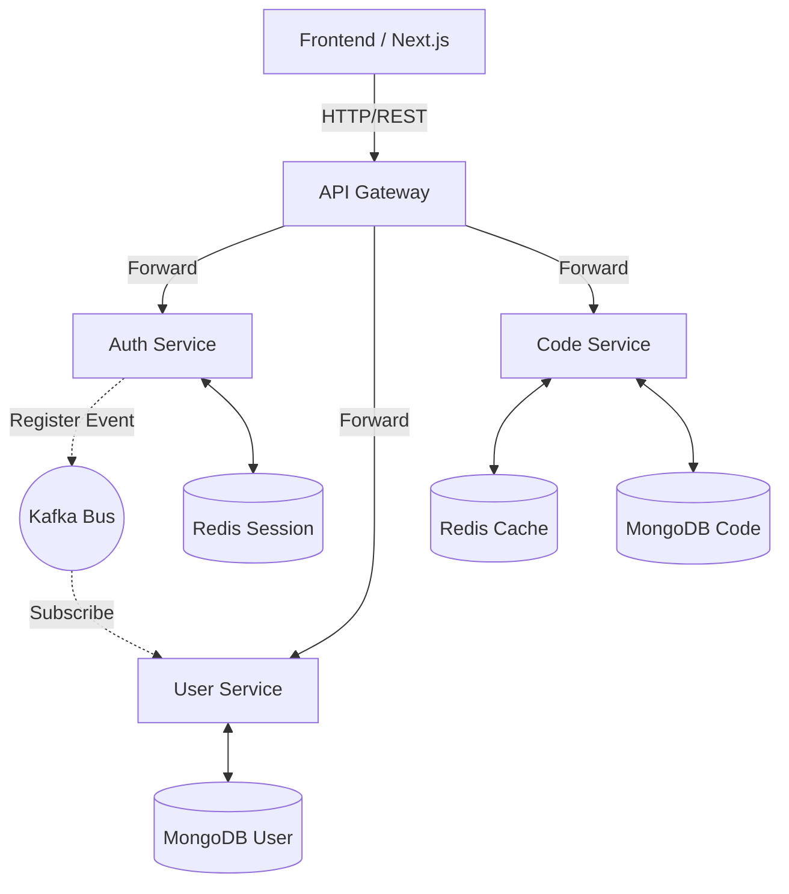

# CEditor

A professional-grade Browser Editor application built with a microservices architecture, featuring aggressive contest security, multi-layered data persistence, and unified JWT authentication.

## 🚀 Services Overview

| Service Name | Port | Description |
| ------------ | ---- | ----------- |
| **API Gateway** | 3000 | Entry point for all requests, handles routing, rate limiting, and CORS. |
| **Auth Service** | 3001 | Handles user authentication (JWT), registration, and token management via Redis. |
| **User Service** | 3002 | Manages user profiles and synchronization via Kafka events. |
| **Code Service** | 3003 | Manages code storage, project metadata, and contest timer persistence. |
| **Frontend** | 3000* | Next.js application with built-in auth middleware and security deterrents. |

## 🏗️ Architecture



## 🛣️ API Routes

All internal service routes are proxied through the API Gateway at `http://localhost:3000/api/v1/`.

### 🔐 Auth Service (`/auth`)
| Method | Endpoint | Description | Auth |
| :--- | :--- | :--- | :--- |
| POST | `/register` | Register a new account | No |
| POST | `/login` | Authenticate and get tokens | No |
| POST | `/refresh` | Get new access token via refresh token | No |
| POST | `/logout` | Revoke session and clear cookies | Yes |
| POST | `/forgot-password` | Request password reset email | No |
| POST | `/reset-password` | Set new password with reset token | No |

### 👤 User Service (`/user`)
| Method | Endpoint | Description | Auth |
| :--- | :--- | :--- | :--- |
| GET | `/profile` | Get current user's profile data | Yes |

### 💻 Code Service (`/code`)
| Method | Endpoint | Description | Auth |
| :--- | :--- | :--- | :--- |
| GET | `/` | List all user's projects | Yes |
| GET | `/:projectId` | Fetch a specific project by ID | Yes |
| POST | `/save` | Save or update a project | Yes |
| GET | `/submissions` | List all user's submissions | Yes |
| GET | `/submissions/:projectId` | List submissions for a specific project | Yes |
| POST | `/submit` | Submit a snapshot of the current code | Yes |

### Infrastructure
- **MongoDB**: Distributed database stores for code and user data.
- **Redis**: Shared store for active session validation across all microservices.
- **Kafka**: Reliable event bus for real-time user data synchronization.

## ✨ Key Features

### 🛡️ Contest Security & Hardening
- **Console Deterrent**: Real-time `debugger` loop detects and penalizes devtool usage.
- **Keyboard Lockdown**: Blocks common developer shortcuts (F12, Ctrl+Shift+I, etc.).
- **Focus Tracking**: Automatic strike system for tab/window switching or exiting fullscreen.
- **Auth Middleware**: Server-side route protection ensuring zero unauthorized entries.

### 💾 Multi-Layer Persistence
- **IndexedDB**: Local auto-save every 2 seconds for zero-loss recovery.
- **Periodic Sync**: Background synchronization to MongoDB every 10 seconds.
- **Timer Persistence**: Contest timer state is saved globally, allowing session resumption.

## 🛠️ Tech Stack

- **Frontend**: Next.js 16, React 19, Monaco Editor, CSS3.
- **Backend**: Node.js, TypeScript, Express.js.
- **Data**: MongoDB (Mongoose), Redis (ioredis).
- **Messaging**: Kafka (kafkajs).
- **DevOps**: Docker, Docker Compose.

## 🚦 Getting Started

### 1. Environment Setup
Create a `.env` file in the root directory by copying the example:
```bash
cp .env.example .env
```
Ensure you set the `JWT_SECRET`, `MONGO_ROOT_PASSWORD`, and other sensitive keys.

### 2. Running with Docker (Recommended)
```bash
docker-compose up --build
```
- **Gateway/App**: [http://localhost:3000](http://localhost:3000)
- **Kafka UI**: [http://localhost:8080](http://localhost:8080)

## ⚠️ Troubleshooting

- **503 Errors**: Ensure `api-gateway` can resolve service hostnames (using default docker bridge).
- **CORP/CORS**: Helmet is configured to allow cross-origin resource sharing for the editor preview.
- **Auth Sync**: If profiles don't sync, ensure the Kafka container is healthy and topics are initialized.

