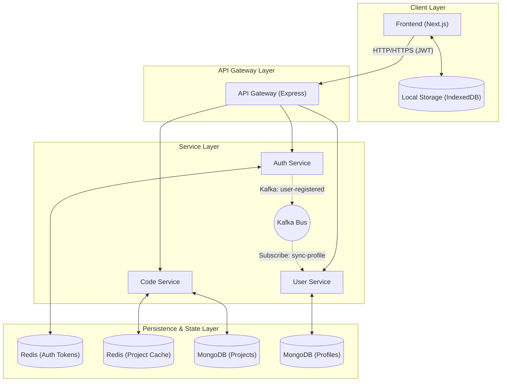

# CEditor

A professional-grade Browser Editor application built with a microservices architecture, featuring aggressive contest security, multi-layered data persistence, and unified JWT authentication.

## 🚀 Services Overview

| Service Name | Port | Description |
| ------------ | ---- | ----------- |
| **API Gateway** | 3000 | Entry point for all requests, handles routing, rate limiting, and CORS. |
| **Auth Service** | 3001 | Handles user authentication (JWT), registration, and token management via Redis. |
| **User Service** | 3002 | Manages user profiles and synchronization via Kafka events. |
| **Code Service** | 3003 | Manages code storage, project metadata, and contest timer persistence. |
| **Frontend** | 3005* | Next.js application with built-in auth middleware and security deterrents. |

> [!NOTE]
> *Frontend port may vary if run locally (typically 3000, 3004, or 3005). The API Gateway at 3000 acts as the unified reverse proxy for all backend services.

## 🏗️ Architecture



## 🛠️ Infrastructure & Data Flow

| Component | Technology | Role |
| --------- | ---------- | ---- |
| **API Gateway** | Node.js/Express | Unified entry point, request proxying, and rate limiting. |
| **Message Broker** | Kafka | Asynchronous event-driven synchronization (e.g., Auth -> User). |
| **In-Memory Store** | Redis | JWT blacklisting, refresh token storage, and project metadata caching. |
| **Main Database** | MongoDB | Persistent storage for user profiles and project code. |
| **Local Cache** | IndexedDB | Client-side "zero-loss" auto-save mechanism for the editor. |

## 🛡️ Security & Hardening

### 🔒 API & Auth Security
- **Unified Gateway**: All services are protected behind the API Gateway.
- **JWT Authentication**: Secure token-based auth with short-lived access tokens and Redis-backed refresh tokens.
- **Environment Isolation**: Secrets are managed via `.env` files (excluded from git).
- **Hardened Cookies**: `httpOnly` and `sameSite: lax` flags on all sensitive cookies, with `secure` flags enabled in production.
- **Rate Limiting**: Integrated rate limiting at the Gateway level to prevent brute-force attacks.

### 🛡️ Contest Security Deterrents
- **Console Deterrent**: Real-time `debugger` loop detects and penalizes devtool usage.
- **Keyboard Lockdown**: Blocks common developer shortcuts (F12, Ctrl+Shift+I, etc.).
- **Focus Tracking**: Automatic strike system for tab/window switching or exiting fullscreen.
- **Strict Enforcement**: Users get 3 warnings; the 4th violation triggers an automatic logout.
- **Submit Restriction**: Submission is strictly allowed only during active contest mode.

## 💾 Multi-Layer Persistence
- **IndexedDB**: Local auto-save every 2 seconds for zero-loss recovery.
- **Periodic Sync**: Background synchronization to MongoDB every 10 seconds.
- **Redis Caching**: `code-service` implements multi-layer caching for project lists and details.
- **Mandatory Projects**: Users must have a project to enter the editor; contests force fresh project creation.

## 🛠️ Tech Stack

- **Frontend**: Next.js (App Router), React, Monaco Editor, IndexedDB.
- **Backend**: Node.js, TypeScript, Express.js, Winston Logger.
- **Data**: MongoDB (Mongoose), Redis (ioredis).
- **Messaging**: Kafka (kafkajs).
- **DevOps**: Docker, Docker Compose.

## 🚦 Getting Started

### 1. Environment Setup
Rename `.env.example` to `.env` in the root directory and update secrets:
```bash
cp .env.example .env
```

### 2. Running with Docker
```bash
docker-compose up --build
```
- **Gateway**: [http://localhost:3000](http://localhost:3000)
- **Kafka UI**: [http://localhost:8080](http://localhost:8080)
- **Redis UI**: [http://localhost:8001](http://localhost:8001)

## ⚠️ Troubleshooting

- **503 Errors**: Check if services are healthy in Docker.
- **Kafka Sync**: Ensure topics are created if profile data doesn't appear immediately.
- **CORS**: Gateway handles preflight; services use secure origin allow-lists.

