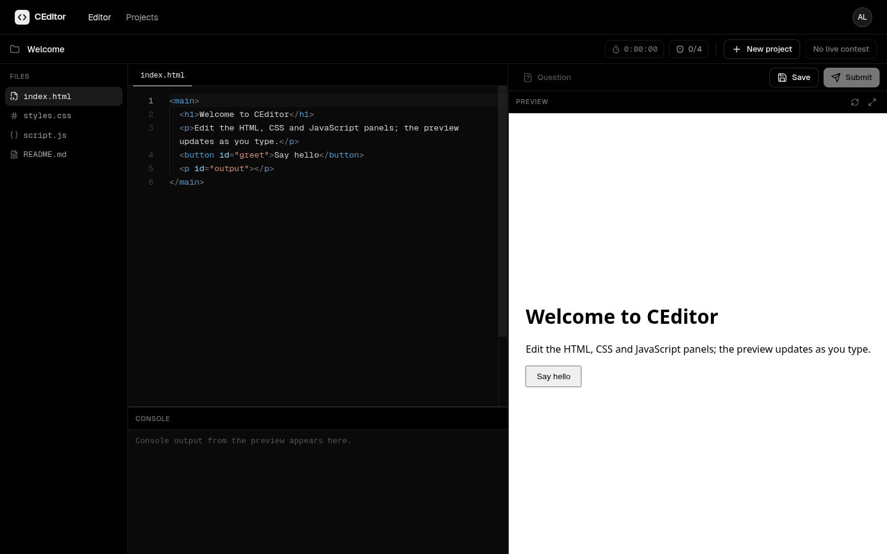
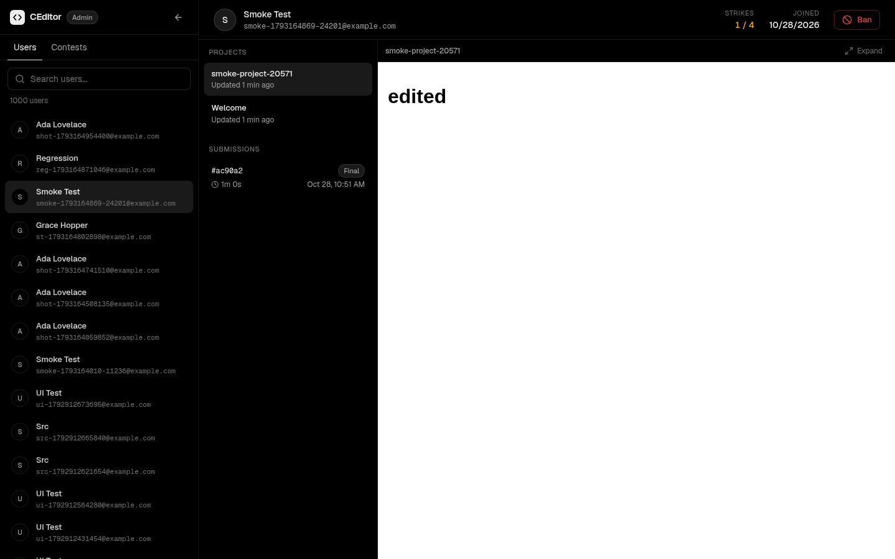
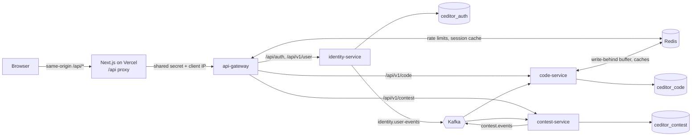

# CEditor

A browser-based HTML/CSS/JS editor with timed coding contests, built as a small
microservice system: an API gateway, three services with their own databases, Kafka events
between them, and Redis for sessions and write-behind saves.

**Live:** https://browser-editor-cyan.vercel.app (Render free tier: the first request after
idle can take ~30–60 s while services wake up).

| Editor | Landing | Admin |
|---|---|---|
|  |  |  |

## Architecture



| Service | Owns | Database | Publishes | Consumes |
|---|---|---|---|---|
| **api-gateway** | Routing, auth check, rate limits, circuit breakers | (Redis only) | | |
| **identity-service** | Sign-up/sign-in (Better Auth, email + Google), sessions, profiles, bans | `ceditor_auth` | `user.registered.v1`, `user.banned.v1`, `user.unbanned.v1` | |
| **code-service** | Projects, saves (Redis write-behind), previews, starter projects | `ceditor_code` | | `user.registered.v1`, `strike.recorded.v1` |
| **contest-service** | Contests, submissions, anti-cheat strikes, disqualification | `ceditor_contest` | `strike.recorded.v1`, `submission.created.v1` | `user.banned.v1`, `user.unbanned.v1` |

Shared code lives in an npm-workspaces monorepo: `packages/common` (config validation,
logging with correlation IDs, Redis/Kafka clients with background retry, health checks,
Prometheus metrics, graceful shutdown, session cache, event publishing/consuming) and
`packages/contracts` (versioned zod schemas for every event).

### A request, end to end

1. The browser calls `/api/v1/code/save` on its own origin. The Next.js proxy forwards it to the
   gateway with a shared secret that vouches for the client IP (used for per-IP rate limits).
2. The gateway validates the session cookie: from its Redis session cache (~5 ms p95), or on a
   miss by asking identity-service, which checks MongoDB. It then applies the per-user rate
   limit and forwards the request with a 60-second token naming the user, signed (Ed25519) for
   that one service, plus an internal secret that only the gateway has. Services verify the
   token with the gateway's public key and ignore any plain `x-user-*` headers.
3. code-service writes the edit to a Redis buffer and returns. A flusher writes buffered
   projects to MongoDB every minute; reads overlay the buffer, so users always see their
   latest edit.

### Events

Services publish after their database commit (retried in the background, no outbox).
Consumers skip already-handled event IDs, so redelivered events are harmless, and send
malformed or repeatedly failing messages to a shared `dead-letter` topic. Messages are keyed
by user ID, so each user's events stay in order. Logs carry the originating request's
correlation ID across services.

| Event | When | Effect |
|---|---|---|
| `user.registered.v1` | Account created | code-service creates a "Welcome" starter project |
| `user.banned.v1` / `user.unbanned.v1` | Admin bans/unbans | contest-service disqualifies / reinstates the user's submissions |
| `strike.recorded.v1` | Anti-cheat strike | code-service mirrors the count on the project |
| `submission.created.v1` | Contest submission | (no consumer yet; for a future grader) |

## Design decisions

One-page records in [docs/adr](docs/adr), each with the alternatives and trade-offs:

1. [Monorepo with shared packages](docs/adr/0001-monorepo-shared-packages.md)
2. [Server-side sessions, gateway cache, explicit revocation](docs/adr/0002-sessions-gateway-cache.md)
3. [Events published after commit, no outbox](docs/adr/0003-events-publish-after-commit.md)
4. [One topic per publishing service, shared dead-letter topic](docs/adr/0004-topic-per-service.md)
5. [Contests split into their own service](docs/adr/0005-contest-service-split.md)
6. [Write-behind saves](docs/adr/0006-write-behind-saves.md)
7. [A database per service](docs/adr/0007-database-per-service.md)
8. [Signed user tokens from the gateway to the services](docs/adr/0008-signed-user-tokens.md)
9. [Rate limits and sign-in lockout keep working without Redis](docs/adr/0009-limits-without-redis.md)
10. [Nonce-based CSP, with previews in a frame page of their own](docs/adr/0010-strict-csp-preview-frame.md)
11. [Contest integrity from signals the server keeps](docs/adr/0011-contest-signals.md)
12. [Scheduled contests with rooms](docs/adr/0012-scheduled-contests-and-rooms.md)

## Results

Every change was load-tested with k6 against the local stack, each app container capped at
0.5 CPU / 512 MB. Details per run in [loadtest/results](loadtest/results).

| | v0 (start) | v5 (final) |
|---|---|---|
| Editor: failed requests | 4.13% | **0%** |
| Editor: p95 (profile / list / open) | 1.88 s / 1.71 s / 1.87 s | **35 ms / 33 ms / 33 ms** |
| Editor: throughput | 24 req/s | **44.4 req/s** |
| Contest autosave: p50 / p95 | 100 ms / 1.78 s | **13 ms / ~195 ms** |
| MongoDB queries during a 5-min contest | 2,916 | **302** |
| Gateway | 2 crashes (memory leak) | 0 restarts |

The biggest steps:
- **v0 → v1:** fixed the gateway memory leak and stale caches.
- **v2 → v3:** the gateway session cache cut gateway p95 from 224 ms to 34 ms. Its first
  version caused a cache stampede, which was then fixed.

**Failure test** ([loadtest/results/chaos.md](loadtest/results/chaos.md)): Kafka,
contest-service, identity-service and Redis taken down one at a time under load.

| Outage | Effect |
|---|---|
| Kafka | No impact on users; events are delivered after it returns |
| contest-service | Only contest calls fail, quickly; editing and saving are unaffected |
| identity-service | Signed-in users keep working on cached sessions |
| Redis | The first run showed code-service hanging. After the fix, reads and saves fall back to MongoDB: 0.3–10% errors instead of 98–100% |

## Running locally

Everything except the frontend runs in Docker (MongoDB, Redis, Kafka and the four services).

```bash
cp .env.example .env    # shared secrets for docker compose
for s in api-gateway identity-service code-service contest-service; do cp $s/.env.example $s/.env; done
cp frontend/.env.example frontend/.env.local
# set BETTER_AUTH_SECRET and INTERNAL_GATEWAY_SECRET (openssl rand -base64 32) in .env
# (.env.example has a local user-token key pair; npm run keys:user-token makes a new one)

docker compose up -d --build --wait
scripts/smoke.sh        # end-to-end check through the gateway

cd frontend && npm install && npm run dev   # http://localhost:3005
```

- **Admin features:** put your email in `ADMIN_EMAILS` (root `.env`).
- **Google sign-in:** add `http://localhost:3005/api/auth/callback/google` as a redirect URI.
- **Optional UIs:** `docker compose --profile tools up -d` starts Redis Insight (:5540) and Kafka UI (:8080).

## Testing

```bash
npm run lint && npm run typecheck
REDIS_TEST_URL=redis://localhost:6379/15 MONGO_TEST_URL=mongodb://localhost:27017/test npm test
scripts/smoke.sh
```

- **Unit tests (67):** the shared packages and contracts. Gateway: client-IP trust, the session
  cache, revocation and fallbacks, routing. code-service: the save path, including the
  mid-flush race and Redis outages, and event idempotency. contest-service: strikes,
  submissions and disqualification. They run against real Redis and MongoDB, which CI provides.
- **Smoke test (30 checks):** sign-up, the starter project event, saving and reading, sign-out,
  a contest (strike → submit), and ban → disqualification → unban.
- **CI** (GitHub Actions) runs all of the above on every PR, plus the frontend build.

## Observability

Every service exposes Prometheus metrics at `/metrics`. The endpoint needs
`Authorization: Bearer $METRICS_TOKEN` and is disabled when that is unset, as in production.
Metrics include:
- HTTP latency per route and Node.js runtime metrics
- dependency status
- session-check time by source, and the session-cache hit ratio
- rate-limit rejections
- write-behind backlog and the flusher
- events published and consumed by outcome
- Redis fallbacks

```bash
docker compose --profile observability up -d   # Grafana :3010 (dashboard "CEditor services"), Prometheus :9090
```

Load and failure tests: [loadtest/README.md](loadtest/README.md), `loadtest/chaos.sh`.

## Deployment

| Part | Where |
|---|---|
| Frontend + `/api` proxy | Vercel |
| Gateway and services | Render (Docker, Blueprint in `render.yaml`) |
| MongoDB | Atlas (one cluster, a database per service) |
| Redis | Upstash |
| Kafka | Aiven, client-certificate TLS (certificates are Render secret files) |

Secrets are set in the Render and Vercel dashboards, never in the repo.
`INTERNAL_GATEWAY_SECRET` comes only from the shared Render environment group: a service-level
copy overrides it and the gateway's requests get 403s.
`USER_TOKEN_PRIVATE_KEY` is set on the gateway only; its public half (`USER_TOKEN_PUBLIC_KEY`)
is in the shared group in `render.yaml`, and the gateway won't start if the two don't match.

## Known limitations

- **No transactional outbox.** An event can be lost if a service dies between its database
  commit and the publish. The publisher logs and counts this; bans are still enforced
  synchronously. See ADR 0003.
- **Without Redis, the gateway has no session cache.** Every request then goes to
  identity-service, which at free-tier capacity returns some 503s (see the failure test).
- **Cold starts.** Render's free tier sleeps idle services, and Kafka consumers sleep with them,
  so the first request can take up to a minute and events wait until the service wakes. The
  landing, login and register pages call the gateway's `/api/wake`, which starts every service
  (at most one ping each per minute), so start-up overlaps with signing in. The editor shows a
  loading screen, and waits up to a minute for a new user's starter project.
- **Sign-in takes ~2 s on the free tier.** Most of it is the password hash (scrypt, ~80 ms on a
  full core) on a fraction of a CPU; lowering its cost would weaken password storage.
- **Without Redis, rate limits and the sign-in lockout are counted per instance** (in memory)
  rather than shared, and an alert fires. Anyone can lock an address for 15 minutes with 10
  wrong passwords. See ADR 0009.
- **Contest anti-cheat is evidence, not proof.** The browser deterrents can be switched off with
  devtools; what holds up is server-side: heartbeats, typed vs pasted counts, code that wasn't
  typed, and similarity to other entries and the target. Flags go to an admin to decide.
  See ADR 0011.
- **Admins are configured by email** (`ADMIN_EMAILS` in each service), not by roles.

## Repository layout

```
api-gateway/        routing, session check, rate limits, circuit breakers
identity-service/   Better Auth, profiles, bans; migration scripts in src/scripts
code-service/       projects, write-behind saves, flusher, event handlers
contest-service/    contests, submissions, strikes; migration script in src/scripts
packages/common     shared infrastructure (see above)
packages/contracts  event schemas and topics
frontend/           Next.js app (Vercel); see frontend/README.md
loadtest/           k6 scenarios, failure test, results per version
observability/      Prometheus and Grafana (local)
docs/adr/           architecture decision records
scripts/smoke.sh    end-to-end smoke test
```
